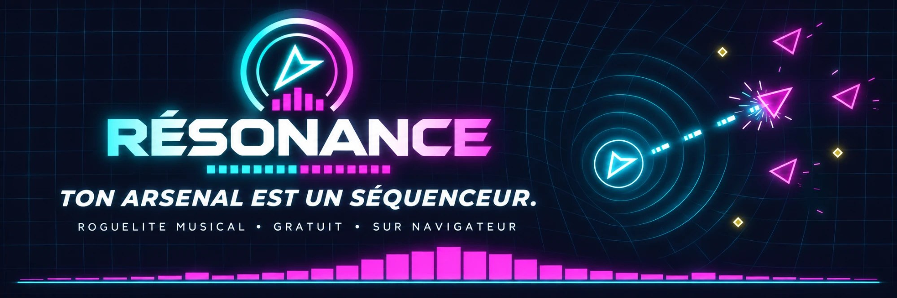
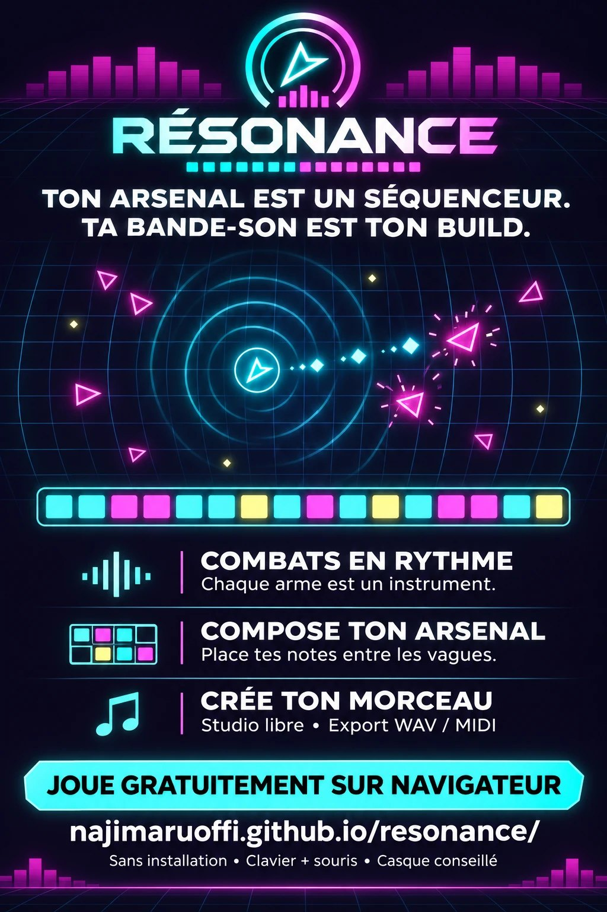

<p align="center">
  <a href="https://najimaruoffi.github.io/resonance/"></a>
</p>

<h1 align="center">RÉSONANCE</h1>

<p align="center"><b>Ton arsenal est un séquenceur. Ta bande-son est ton build.</b></p>

<p align="center">
  <a href="https://najimaruoffi.github.io/resonance/"><b>▶ JOUER GRATUITEMENT</b></a>
  &nbsp;·&nbsp; Navigateur &nbsp;·&nbsp; Clavier + souris &nbsp;·&nbsp; Casque conseillé
</p>

Résonance est un roguelite d'arène, jouable dans le navigateur, où **chaque arme est une piste d'un
séquenceur 16 pas**. Le canon tire sur la grosse caisse, les aiguilles sur le charleston, l'onde de
choc sur la caisse claire, le laser sur la basse et l'essaim de missiles sur l'arpège.
Chaque tir est une note, jouée pile sur le temps. Améliorer son arsenal revient donc à **composer** :
entre deux vagues, tu places de nouvelles notes sur la grille, tu débloques des instruments et tu
modifies leur son. Chaque partie devient un vrai morceau structuré, que tu peux écouter,
retravailler dans le **Studio de création** et exporter en **.wav** ou en **.mid**.

- **Zéro dépendance** : tout le son est synthétisé en direct avec la Web Audio API (aucun
  sample), tous les visuels du jeu sont dessinés en Canvas 2D. Les seules images sont celles
  de l'identité visuelle (logo, bannière, affiche).
- **Vanilla JS, modules ES** : aucun framework, aucune étape de build.

## Lancer le jeu en local

Aucune installation : seul [Node.js](https://nodejs.org) est nécessaire pour le petit serveur de développement.

```powershell
git clone https://github.com/NajimaruOffi/resonance.git
cd resonance
node serve.js
```

Puis ouvrir <http://localhost:4318>. Casque recommandé.

Le jeu est un site 100 % statique : n'importe quel hébergement de fichiers (GitHub Pages,
Netlify, un hébergement web classique…) suffit pour le publier, sans serveur ni base de données.

```powershell
npm test
```

(56 tests unitaires : justesse harmonique dans toutes les tonalités et tous les modes, noms d'accords, arrangeur, sections, morceau de partie, projet Studio, WAV, validité du MIDI, vagues, améliorations, progression.)

## Contrôles

| Action | Touches |
|---|---|
| Se déplacer | ZQSD / WASD / flèches (positions physiques : marche en AZERTY comme en QWERTY) |
| Viser | Souris |
| Dash | Espace / Shift |
| DROP | E / clic droit |
| Pause | Échap / P |
| Choisir une amélioration | Clic ou 1 · 2 · 3 (· 4) — R pour relancer |

## Ce qui rend le jeu unique

| Mécanique | Détail |
|---|---|
| **Armes = pistes** | 5 instruments/armes, chacun une ligne de 16 pas. Une case allumée = un tir sur cette double-croche. |
| **Composer pour progresser** | Les améliorations « Nouvelle note » te font placer la note toi-même ; tu l'entends en direct en survolant la grille. |
| **Toujours musical** | Gammes et progressions d'accords par secteur : basse, arpèges, nappes et même les sons de mort des ennemis (pentatonique) restent dans la tonalité. Les éliminations enchaînées jouent une mélodie qui monte. |
| **Dash parfait** | Un dash à ±90 ms d'un temps : invulnérabilité prolongée, traînée offensive, recharge réduite de moitié, +5 combo. |
| **DROP** | La jauge se remplit avec les éclats. Activé, il attend le prochain « 1 » de la mesure (une montée joue pendant l'attente), puis frappe tout l'écran et double les dégâts pendant 2 mesures. |
| **Ennemis rythmiques** | Les fléchettes bondissent sur les temps, les sentinelles tirent sur le « 1 », le boss **Le Métronome** a un balancier qui touche ses extrémités exactement sur la pulsation. Chaque attaque est télégraphiée un temps à l'avance. |
| **Accélérando** | Une amélioration augmente le BPM : tu tires plus vite, mais tout le reste aussi. |
| **Graines** | Chaque partie a une graine rejouable ; le *Défi du jour* donne la même partie à tout le monde. |

## Créer de la vraie musique

Résonance est aussi un **outil de composition**. La musique n'est pas une boucle : c'est un
moteur d'arrangement qui transforme ce que tu composes en morceau structuré.

### Ce que le moteur musical fait de ta grille

| Couche | Détail |
|---|---|
| **Harmonie** | Accords diatoniques avec 7e (Am7, Fmaj7, G7, Bm7b5…), progressions en deux parties A/B sur des phrases de 8 mesures, voicings serrés, 7 modes (mineur, dorien, phrygien, mineur harmonique, majeur, mixolydien, lydien), 10 progressions nommées. |
| **Mélodies du joueur** | Basse et lead s'écrivent dans un **piano roll en tons de l'accord** (fondamentale, tierce, quinte, 7e, octave…). La mélodie suit l'harmonie : elle ne sonne jamais faux, dans n'importe quelle tonalité. |
| **4 styles** | Un par secteur, avec sa propre lutherie : **Synthwave** (supersaw, cordes), **Acid techno** (basse 303 résonante avec accents et glissés, clap, grondement), **Deep garage** (swing à 20 %, sub, cloches FM, rimshot), **Breakbeat** (basse reese, cuivres, orgue). |
| **Phrasé et groove** | Développement du motif (réponse sur la mesure 4, variation sur la 7, envolée à l'octave en fin de phrase), swing par style (le gameplay est synchronisé dessus), vélocités humanisées, notes fantômes, fills de batterie en fin de phrase, crash en début de phrase. |
| **Mix** | Stéréo (panoramiques, supersaw large, delay ping-pong), réverbe filtrée dans le grave, sidechain de la nappe sur la grosse caisse, compression. |

### Ta partie devient un morceau

Chaque vague est enregistrée. En fin de partie, le jeu compose un **titre structuré** :
intro filtrée → un couplet par vague (le boss dure deux fois plus longtemps) → **montée + drop**
là où tu as déclenché un DROP → **break** qui module à chaque changement de secteur → outro.
Le titre est rangé dans la **discothèque**. Tu peux l'écouter dans le jeu, l'exporter en
**WAV** (44,1 kHz stéréo) ou en **MIDI** (batterie GM, basse, lead et nappe sur 4 pistes,
tempo et sections inclus, prêt pour un logiciel de musique), ou le retravailler dans le Studio.

### Studio de création (mini-DAW)

- Deux **patterns** (A/B) : batterie en pas à pas, basse et lead en piano roll, écho par piste,
  « ✦ Inspirer » pour proposer une nouvelle mélodie sur le même rythme.
- **Son** : style, tonalité (12 notes × 7 modes), progression, tempo ; les accords des 8 mesures
  s'affichent et s'allument pendant la lecture.
- **Arrangement** : sections (intro, couplet, montée, drop, break, outro) avec leur pattern et
  leur longueur, réordonnables, et 4 structures types (Club, Couplet/refrain, Court, Boucle).
- **Boucle en direct** (Espace) pendant l'édition, écoute du **morceau complet**, export WAV/MIDI,
  sauvegarde dans la discothèque.

Le jeu, l'écoute et les exports utilisent **le même arrangeur déterministe**. Ce que tu entends
en jouant est exactement ce que tu télécharges. Le rendu hors-ligne est planifié par tranches
de 2 s, avec libération des voix terminées : environ 9× plus rapide que le temps réel.

## Méta-progression : pourquoi relancer une partie

Chaque partie fait avancer le joueur, même quand elle se termine mal. Il y a quatre boucles :

| Système | Gain | Débloque |
|---|---|---|
| **Niveau de musicien** (XP) | Score, vague atteinte, boss, dash parfaits | **6 kits de départ** aux niveaux 1, 2, 4, 6, 8 et 10. Chacun change le style de jeu : Breakbeat (corps à corps), Acid (lasers), Arpégiateur (missiles), Minimal (1 arme mais +1 carte), Polyrythmie (rythme en 3 contre 4). |
| **Échos ◈** | Chaque partie + succès | **Studio** : 8 améliorations permanentes à plusieurs niveaux (PV, dégâts, relances d'offres, 4ᵉ carte, jauge de DROP pré-remplie, fenêtre de dash parfait élargie…). |
| **Intensité 0 à 10** | Atteindre la vague 10 débloque le palier suivant | Des contraintes cumulatives (PV et vitesse des ennemis, tempo, plus de soin…) avec **+20 % de gains par palier**. C'est l'objectif de long terme. |
| **24 succès** | Notification en pleine partie | Des objectifs concrets et variés (boss sans être touché, piste remplie, 150 BPM, 4 kits différents…). |

L'écran de fin anime la barre d'XP et les passages de niveau, liste les déblocages et indique
toujours **le prochain objectif** (prochain kit, prochain achat possible au Studio).

## Architecture

```
Resonance/
├── index.html            écrans + HUD (DOM), aperçu des liens (Open Graph)
├── assets/               logo, bannière, affiche, icônes, image d'aperçu
├── css/style.css         interface néon, thème recoloré par secteur (variables CSS)
├── serve.js              serveur statique sans dépendance
├── src/
│   ├── main.js           assemblage + boucle requestAnimationFrame
│   ├── audio/
│   │   ├── engine.js     synthèse : kick, snare, hat, basse, lead, nappes, SFX, réverbe, delay, sidechain
│   │   ├── clock.js      horloge à planification anticipée, swing, compensation de latence
│   │   └── export.js     rendu hors-ligne par tranches, encodeur WAV, écriture MIDI
│   ├── music/
│   │   ├── theory.js     gammes, accords de 7e, progressions A/B, voicings, noms d'accords
│   │   ├── styles.js     4 genres (lutherie, groove, mix)
│   │   ├── arranger.js   grille → événements musicaux (pur, partagé jeu / exports)
│   │   ├── motif.js      génération de motifs mélodiques
│   │   ├── song.js       modèle de morceau, partie → titre structuré
│   │   ├── project.js    projet du Studio (patterns, arrangement)
│   │   └── library.js    discothèque
│   ├── studio.js         Studio de création + discothèque (interface)
│   ├── songtools.js      écoute, exports, affichage de structure
│   ├── game/
│   │   ├── game.js       état, armes, collisions, vagues, DROP, caméra
│   │   ├── enemies.js    6 types + boss, comportements continus et sur le temps
│   │   ├── waves.js      génération déterministe des vagues (pure)
│   │   ├── upgrades.js   14 améliorations, tirage pondéré (pur)
│   │   ├── tracks.js     définition des pistes/armes
│   │   ├── particles.js  pool de particules en tableaux typés
│   │   └── grid.js       grille de fond à ressorts qui se déforme
│   ├── meta/progression.js  niveaux, kits, Studio, intensité, succès, récompenses (pur)
│   ├── render/renderer.js  Canvas 2D additif, halos pré-calculés, bloom basse résolution
│   ├── ui.js             écrans, séquenceurs, cartes, fin de partie
│   ├── input.js          clavier (event.code) / souris
│   └── storage.js        réglages et records (localStorage, tolérant aux erreurs)
├── tests/               tests node:test (cœur + progression)
└── docs/GDD.md           game design document
```

### La synchronisation son ↔ gameplay

Le point technique central : le jeu ne « déclenche » pas des sons, c'est **l'horloge audio qui
déclenche le jeu**.

1. `Clock.pump()` planifie chaque double-croche ~120 ms à l'avance sur l'horloge du `AudioContext`
   (précision à l'échantillon, insensible aux saccades du rendu).
2. Chaque pas planifié est mis en file. `Clock.drain()` le délivre au gameplay quand
   `currentTime − outputLatency` atteint son horodatage — c'est-à-dire **au moment où le joueur
   l'entend**. Le tir part donc visuellement en même temps que le son sort du casque.
3. Les jugements de timing (dash parfait) et l'animation (pulsations, balancier du boss) utilisent
   ce même « temps entendu ».
4. Le DROP est planifié sur le prochain « 1 » calculé à partir des pas déjà en file, ce qui
   permet de jouer une montée de durée exacte avant l'impact.

### Performances

- Hachage spatial pour les collisions, pools de particules en `Float32Array`.
- Halos : sprites radiaux pré-rendus par couleur, mis en cache.
- Bloom : copie du canvas au quart de résolution, flou, recomposition additive (désactivable).
- Limitation de densité des effets sonores pour éviter la saturation lors des grosses explosions.

## Pistes d'évolution

- Manette (Gamepad API) et contrôles tactiles.
- Automation par section dans le Studio (filtre, volume par piste) et patterns C/D.
- Partage d'un morceau par lien (projet encodé dans l'URL).
- Classement en ligne pour le Défi du jour.
- Nouveaux instruments (clap = mines, pad = bouclier) et nouveaux boss par secteur.

## Affiche

<p align="center"></p>

## Licence

© 2026 NajimaruOffi — tous droits réservés. Le code est consultable publiquement, mais sa
réutilisation, sa copie ou sa redistribution nécessitent une autorisation écrite. Voir [LICENSE](LICENSE).
